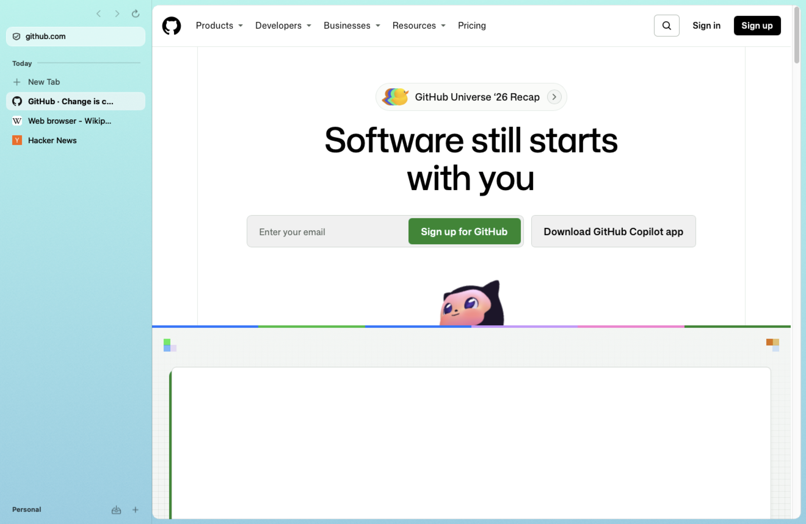

# Vane

A privacy-first, keyboard-driven browser for macOS in the spirit of Arc: a sidebar of vertical tabs, spaces you swipe between, folders, and a command palette. Native Swift and AppKit on the system WebKit, so it idles at 0% CPU and about 40 MB and feels like a Mac app.



> This repository previously held a Chromium/Helium-based prototype. It is preserved on the [`helium-archive`](../../tree/helium-archive) branch.

## Build and run

```sh
swift test                      # ~200 tests
scripts/bundle.sh release       # → build/Vane.app as "Vane Dev" (own data folder)
scripts/install.sh              # → /Applications/Vane.app (real identity)
scripts/bench-memory.sh         # idle footprint vs the 150 MB budget
scripts/bench-compare.sh        # Vane vs Chromium (Edge, throwaway profile)
```

Requires macOS 15.4+, Xcode 26+ (Swift 6).

## Faster and lighter than Chromium

Measured with the same 5 sites open (`docs/benchmarks.md`):

| | Vane | Microsoft Edge |
|---|---|---|
| Launch to first window | **0.6 s** | 1.0–1.3 s |
| Total memory, all processes | **666–752 MB** | 1,301–1,335 MB |
| Idle app process | **40 MB** | n/a |

## What works today (verified on this Mac, 2026-11-11)

| Area | Status | Evidence |
|---|---|---|
| Sidebar: favorites grid, pinned, Today, sleeping tabs, spaces | ✅ | Light and dark screenshots |
| Command palette (⌘K / ⌘T / ⌘L): tabs, history, favorites, commands, inline completion | ✅ | fzf V2 port; 20k candidates in 3–6 ms (release) |
| Local history: SQLite, frecency, FTS5 | ✅ | 23 tests |
| Ad and tracker blocking: EasyList + EasyPrivacy → 119,970 WebKit rules | ✅ | The Verge: third-party hosts went from 42 to 11, with no doubleclick, Amazon ads, Criteo, GTM or Facebook |
| Blocking from the first request at launch | ✅ | Compiled lists looked up by ID before tabs restore |
| Cosmetic filtering, tracking-parameter stripping | ✅ | Tests |
| Fingerprinting defenses (canvas/audio/WebGL noise, normalized hardware hints) | ✅ | Canvas hash stable within a site, different across sites and sessions |
| Tab hibernation (idle, memory pressure, manual) | ✅ | WebKit memory went from 751 MB to 300 MB when 4 of 5 tabs slept |
| App process memory | ✅ | 40 MB idle; 54–57 MB with 5 sites (budget 150 MB) |
| Spaces with separate cookies and logins | ✅ | httpbin: a cookie set in one space is absent in another |
| Two-finger swipe between spaces: live pages, velocity-matched spring, gradient cross-fade | ✅ | 0 dropped frames at 120 Hz; <0.5 ms main-thread per frame (`--swipe-benchmark`) |
| Per-space gradient themes with grain, 10 presets, automatic light/dark text | ✅ | Light and dark screenshots |
| Arc-style folders in Pinned (inline rename, collapse, drag in, context menu) | ✅ | Tests + screenshot |
| Settings dashboard (Appearance live preview, Spaces gradient editor, Privacy, Tabs, Passwords, Extensions, Downloads) | ✅ | All panes rendered in light and dark |
| Vertical sidebar or Tabs on Top (View menu, ⌘K, or Settings) | ✅ | Screenshot |
| Rename / theme / icon / delete spaces (right-click a space chip, Settings, or ⌘K) | ✅ | |
| Library: downloads and media (⌥⌘J, or the tray button) | ✅ | Real downloads listed; media grid with thumbnails |
| Now playing: background audio/video mini player with play/pause and PiP | ✅ | Background track detected and controllable |
| Private windows (own space, non-persistent, never saved, reopened or listed elsewhere) | ✅ | `--private-test` |
| Reader mode (Readability + DOMPurify, script-free view with CSP) | ✅ | Screenshot |
| Find on page, downloads, session restore, archive of stale tabs | ✅ | |
| Password manager (Keychain), CSV import/export from Passwords, Safari, Chrome | ✅ | Real-Keychain round trip |
| Autofill banner (fill / save / update) | ✅ | Live login form: detected, submitted, offered to save in < 1 ms |
| Passkeys from iCloud Keychain | ⏳ Needs Apple's entitlement; until then sites are told passkeys are unavailable and fall back to passwords | See below |
| DNS-over-HTTPS (Quad9 by default; Cloudflare, Mullvad) | ✅ | Connection reports show `dnsProtocol=https`; pages load through the proxy |
| Import from Arc (spaces, favorites, pinned), Chromium browsers, Safari | ✅ Tested on sample files | Arc isn't installed here, so it hasn't been tried on real Arc data |
| Chrome Web Store extensions ("Add to Vane" on store pages, ⌘K → Add Extension) | ✅ MV3 via WebKit | uBlock Origin Lite installed from the store, loaded with no errors, popup works; Dark Reader loads; Bitwarden's background script fails |

## Apple Passwords: what's possible

- **Passkeys (iCloud Keychain):** these work once Apple grants the `com.apple.developer.web-browser.public-key-credential` entitlement. Only the Account Holder of a paid Apple Developer organization can request it, at https://developer.apple.com/contact/request/macos-browsers-passkeys/. After approval, sign with Developer ID plus the provisioning profile, and WebKit handles WebAuthn natively. The Settings window shows the current status.
- **Saved iCloud Keychain passwords:** Apple offers no API for third-party browsers to read or write them. Chrome and Arc only get them through Apple's extension, which Apple allow-lists per browser. Vane keeps its own passwords in the macOS Keychain instead, and imports them from the Passwords app (File → Import Passwords).
- **Verification codes from Messages and Mail:** macOS fills these system-wide. This hasn't been checked on a live site yet.

## How it was built

Research notes behind each decision are in `docs/research/`, design mockups (made with the stageshow skill) in `docs/design/` and `design/stageshow/examples/aegis-*`. Two adversarial QA agents and a critical checker reviewed the app; their joint list is in `docs/qa-round1.md`.

## Architecture

See `CLAUDE.md` for the module map and rules. Every decision is backed by a research note in `docs/research/`.

## Known limits

- Extensions: WebKit's runtime supports MV3 and declarativeNetRequest, but not blocking `webRequest`, `offscreen`, `sidePanel`, `identity` or native messaging, so some extensions (e.g. Bitwarden) don't work yet. Extensions don't auto-update yet.

- WebKit can't intercept http/https requests, so blocking is declarative. 696 of 134k filters, such as procedural cosmetics and scriptlets, can't be expressed.
- Fingerprint defenses run in the page world and can be detected by scripts like CreepJS.
- Sites behave as they do in Safari, quirks included. A few sites misbehave when a non-Safari app identifies as Safari (Google Docs rendered its canvas at half resolution), so `SiteQuirks` adjusts the user agent for them.
- Ad-hoc builds change their code signature on every rebuild, so macOS may ask again for Keychain access.

## Licenses

Readability (Apache-2.0), DOMPurify (Apache-2.0/MPL-2.0), and EasyList/EasyPrivacy (GPLv3 / CC BY-SA 3.0, shipped as data). See `Sources/ContentBlocking/Resources/lists/LICENSE-filter-lists.txt`.
